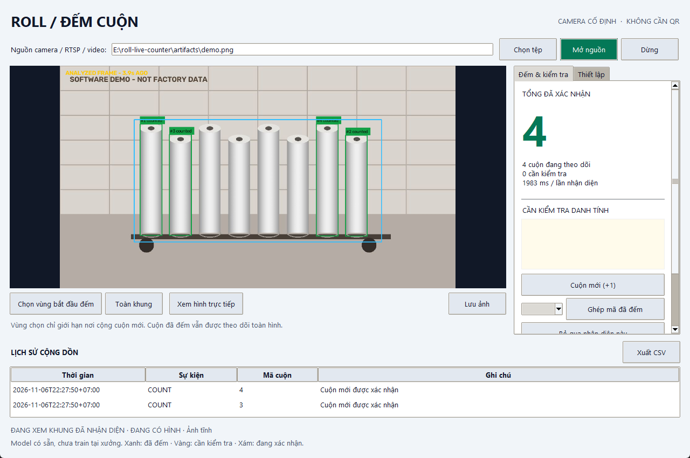

# Roll Live Counter

Ứng dụng Windows độc lập đếm cuộn bằng camera cố định, không cần QR.

**[Tải bộ cài Windows](https://github.com/huybitvvt/roll-live-counter/releases/latest/download/RollLiveCounter-Setup.exe)** ·
[Hướng dẫn](HUONG-DAN.md) · [Kết quả kiểm chứng và giới hạn](VALIDATION.md)



Ảnh minh họa có 8 cuộn vẽ; model có sẵn nhận được 4 cuộn trong lần kiểm tra vùng
cắt này. Ảnh thể hiện cả giới hạn bỏ sót của bản chưa train, không chứng minh độ đúng tại xưởng.

## Bản 0.1.0 làm được gì?

- Camera USB (nhập `0`, `1`...), RTSP, video và ảnh; không cần Python, API key hay GPU NVIDIA.
- Model **YOLOE-11s-seg có sẵn**, đã nhúng các mô tả cuộn vào ONNX. Bộ cài chứa model;
  chạy inference offline, không tải weights hoặc gửi hình lên server.
- BoT-SORT giữ quỹ đạo; lớp bộ nhớ riêng giữ danh tính và tổng đã xác nhận.
- Chọn **vùng bắt đầu đếm**: chỉ cộng vật thể mới trong vùng, vẫn theo dõi cuộn cũ
  trên toàn hình khi nhân viên chuyển chúng đi. Quét bổ sung ảnh cắt vùng để giữ chi tiết.
- Xác nhận qua nhiều lần quan sát. Vật thể mất ID có ngoại hình giống cuộn cũ sẽ vào
  danh sách cần kiểm tra. Có **Cuộn mới (+1)**, **Ghép mã đã đếm**, **Bỏ qua** và ảnh đối chiếu.
- Giữ tổng và danh tính qua lần đóng/mở app. Không tự chia hay reset theo xe.
- Lịch sử SQLite, xuất CSV UTF-8 và chức năng lưu ảnh để tạo dataset sau này.
- Hai tiến trình riêng cho camera và nhận diện, hàng đợi có giới hạn, lấy hình mới,
  giới hạn thread, phát hiện nguồn treo và kết nối lại có giới hạn.

## Giới hạn phải hiểu trước khi sử dụng

**Đây là bản để chạy thử tại xưởng, chưa được nghiệm thu độ chính xác hoặc chạy 24/24.**

Anh chưa có data cuộn để train. Vì vậy, bản này dùng YOLOE đã huấn luyện sẵn theo
mô tả, **không phải RTMDet-Ins-s đã fine-tune cho cuộn**, và không chứa model ReID
được train trên cuộn. Đặc trưng HOG/màu chỉ gợi ý trường hợp cần kiểm tra;
không được coi là dấu vân tay của từng cuộn.

Model có thể bỏ sót cuộn nhỏ/che khuất hoặc nhận nhầm vật khác. Không có đảm bảo
đếm chính xác mọi cuộn bạc giống nhau. Một cuộn bị che hoàn toàn có thể không phân
biệt được với cuộn mới khi xuất hiện lại. Tổng chỉ gồm danh tính đã xác nhận;
các mục cần kiểm tra chưa được cộng. Chỉ đếm cuộn khi camera nhìn thấy đủ bằng chứng,
không suy ra số cuộn bị che kín từ một ảnh.

Model được xuất với sáu prompt cố định: `cylinder`, `roll`, `insulation roll`,
`foil roll`, `plastic roll`, `paper roll`. Prompt hình trụ có thể nhận nhầm vật
hình trụ khác; giới hạn vùng xe và kiểm tra thực tế là cần thiết. Thay prompt cần xuất lại model;
thay đổi ngưỡng không biến model có sẵn thành model chuyên cho xưởng.

## Cài và dùng

Windows 10/11 x64. Cài và mở **Roll Live Counter**. Nhập đúng nguồn rồi bấm
**Mở nguồn**. Lần đầu, app chỉ xem/nhận diện; chọn vùng bao quanh xe để bắt đầu
cộng cuộn, hoặc bấm **Toàn khung** để chủ động đếm cả hình. Không chọn cả các cuộn
ở tiền cảnh nếu chỉ đếm xe. Lựa chọn này được giữ cho lần mở app tiếp theo.

Đọc [HUONG-DAN.md](HUONG-DAN.md) để chọn vùng, xử lý các mục vàng và thu data.
Ứng dụng không thay đổi power plan; Windows cần tiếp tục hoạt động khi dùng camera.

## Dữ liệu local và giới hạn tài nguyên

Tất cả ở `%LOCALAPPDATA%\RollLiveCounter`. Gỡ/cài lại app không tự xóa dữ liệu.

- `history.db`: danh tính và toàn bộ sự kiện. Lịch sử không tự xóa; người vận hành
  quản lý dung lượng, xuất CSV và sao lưu khi cần.
- `identities/`: ảnh nhỏ tham chiếu từng cuộn. Không tải lên GitHub hay cloud.
- `samples/`: chỉ thu tự động khi bật tùy chọn, tối đa 500 JPG hoặc 2 GB,
  mỗi 10 giây một ảnh. JSON đi kèm là gợi ý chưa được kiểm tra nhãn.
- `app.log` và `inference.log`: tối đa khoảng 4 MB mỗi loại. Bộ nhớ hiện tại tối đa 5.000 danh tính, đạt giới hạn
  thì ngừng tự cộng danh tính mới; không âm thầm quên cuộn cũ để giải phóng chỗ.
- Camera giới hạn ảnh preview tối đa 1280×720, giữ tỉ lệ; quét mặc định tối đa 4 lần/s.
  Nhịp thực tế phụ thuộc CPU và số lượt quét vùng. Hình cũ bị bỏ, không xếp hàng vô hạn.

Tổng/bộ nhớ được giữ cả khi đổi nguồn camera hoặc mở video. Nếu đổi sang một cảnh
khác và muốn đếm lại, dùng nút đặt lại rõ ràng; không có reset ngầm.

## Phát triển và build

Python 3.12 x64, Inno Setup 6. Bộ cài không chứa PyTorch/Ultralytics runtime.

```powershell
python -m venv .venv
.venv\Scripts\python.exe -m pip install -r requirements-build.txt
.venv\Scripts\python.exe tools\download_model.py
.venv\Scripts\python.exe -m pytest -q
.venv\Scripts\python.exe -m roll_counter
powershell -NoProfile -ExecutionPolicy Bypass -File tools\build_windows.ps1
```

Tạo lại ONNX từ pretrained checkpoint (cần mạng ở bước build, không train):

```powershell
.venv\Scripts\python.exe -m pip install -r requirements-export.txt
.venv\Scripts\python.exe tools\prepare_model.py
```

`requirements-lock.txt` ghi môi trường build thực tế. `assets/models/manifest.json`
ghi prompt và SHA-256. Ứng dụng kiểm tra hash trước khi nạp model.
Đầu ra: `dist/installer/RollLiveCounter-Setup-0.1.0.exe` và `SHA256SUMS.txt`.

Mã nguồn phát hành theo AGPL-3.0-or-later; xem [thành phần bên thứ ba](THIRD-PARTY-NOTICES.md).
